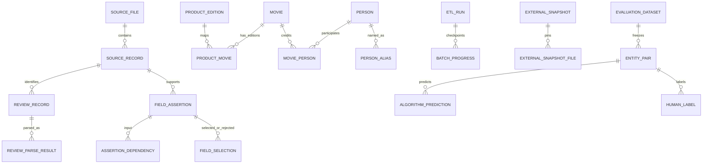

# 阶段7 ER图与字段字典

## 核心ER图

图中的SourceRecord、FieldAssertion、FieldSelection和AssertionDependency是字段级血缘主链；日志不替代这四类关系。ProductEdition与Movie分离，因此一个合集商品可以映射多个作品，评论仍只挂商品，不复制成多条评价。

## 关键表字典

| 表 | 粒度/稳定键 | 关键字段 | 来源或约束语义 |
|---|---|---|---|
| `meta.source_file` | 一个不可变源文件，`sha256`唯一 | URI、大小、解析器、完整性 | 原文件不复制、不修改 |
| `raw.source_record` | 一个源记录/响应 | record_number、locator、hash、raw_payload | 可从文件定位或Base64恢复 |
| `staging.review_record` | 一个物理评论块，稳定`source_review_id` | source_record_id、record_number、content_sha256 | 与解析版本分开 |
| `staging.review_parse_result` | `(source_review_id, parser_version)` | ASIN、用户、评分、正文、状态、问题 | 旧版本不覆盖；当前视图防重复统计 |
| `target.product_edition` | 一个ASIN商品版本 | format、地区、cut、商品发售日期、分类 | 与作品上映语义分离 |
| `target.movie` | 一个电影作品 | stable_key、标题、上映日期/精度/地区/类型 | `imdb:tt...`只是已采用外部身份的一种稳定键 |
| `target.product_movie` | 一个商品—作品关系 | relationship_type、mapping_status、decision_id | 合集允许多行；被拒绝关系不采用 |
| `target.person` | 一个集成人物 | stable_key、canonical_name、status | 不按姓名单独合并 |
| `target.person_alias` | 一个人物的一条来源署名 | raw/normalized alias、source_record_id | 规范化仅检索，不等于身份 |
| `target.movie_person` | 一项作品—人物—角色—来源事实 | role、credited_as、order、source_record_id | principals只代表主要署名，不是完整演员表 |
| `integration.field_assertion` | 某实体字段的一个候选值 | raw/normalized、semantics、locator、quality | 采用与拒绝候选均可保留 |
| `integration.assertion_dependency` | 一个输出断言对一个输入断言的边 | operation、rule、run | 表达转换链 |
| `integration.field_selection` | 一个选择版本对一个实体字段的决定 | selected IDs、status、reason | 历史追加；当前视图只取最新事件 |
| `integration.merge_decision` | 一对实体在一个规则版本下的决定 | merge/do_not_merge/manual_review、origin、evidence | 规则预测与人工决定来源分开 |
| `integration.movie_person_source_evidence` | 一项关系的一条IMDb来源证据 | source IDs、role、characters、selection reason | 可区分selected/supporting/conflicted |
| `meta.quality_issue` | 一项可定位质量问题 | code、severity、entity、source、details | 与有效/隔离互斥分类分开统计 |
| `integration.lineage_field_catalog` | 一个需要审计的最终字段/关系 | 语义、适用分母、最终位置、血缘模式 | 明确候选库存不等于已采用实体；技术字段登记生成规则 |
| `meta.lineage_audit_run/progress` | 一个审计版本与组件进度 | 激活解析/去重版本、范围、状态、统计 | 长扫描组件状态可查询；单个集合SQL内部不伪造记录级检查点 |
| `integration.lineage_audit_result/gap` | 一字段的覆盖率及具体缺口 | 适用、非空、完整链、缺值、缺来源、冲突 | 缺值与缺来源分开；全量未跑前不标全量通过 |
| `integration.relationship_source_link` | 一条关系到一条原始记录 | 关系键、证据角色、字段成员、规则和原因 | 只关系化决定中已保存的source_record_id，不由最终值反推 |
| `integration.lineage_repair_event` | 一次可重入血缘修复 | 前后状态、来源、原因、run | 保存修复批次和幂等证据 |
| `target.current_movie_person` | 当前有效作品—人物关系 | 过滤superseded/retired历史行 | 历史MoviePerson仍保留在基础表 |
| `evaluation.dataset/entity_pair` | 一个冻结评价集及一对盲评实体 | manifest、stratum、display evidence、links | development实体排除，预测不展示 |
| `evaluation.algorithm_prediction` | 一对实体的一个规则预测 | rule、prediction、evidence | 冻结后不因人工答案覆盖 |
| `evaluation.human_label` | 一次追加式人工标签 | label、reason、annotator、time、channel | `cannot_determine`不强制转正/负 |

完整类型、检查约束和索引以`sql/001_core_schema.sql`至`sql/016_stage7_query_views.sql`为准。

